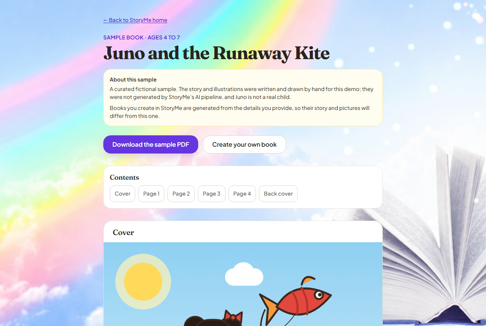

# StoryMe

StoryMe creates personalized illustrated children's books. A parent describes a child aged
1–12, chooses a theme and a language (English, Russian or Polish), and optionally adds a lesson
and a reference photo. StoryMe writes an age-appropriate story of 4–12 pages with the child as
the hero, illustrates every page in a cartoon storybook style, and publishes the book to an
authenticated in-browser reader and a downloadable PDF.



_The public `/sample-book` page, captured from a local production build. This sample is
manually curated: its story and illustrations were written and drawn by hand, not generated by
StoryMe. Books generated in the demo use deterministic mock providers, which demonstrate that the
pipeline executes end to end, not the quality of a real model._

## What it does

1. **Sign in.** Email/password accounts with verification, JWT access tokens and a rotating
   `HttpOnly` refresh cookie.
2. **Describe the child.** Name, age, theme, language, page count, an optional lesson and photo;
   reusable child profiles can prefill a book.
3. **Generate.** The request is scheduled transactionally (PostgreSQL run plus outbox event) and
   executed by a BullMQ/Redis worker: character profile, story, deterministic quality checks,
   page illustrations, layout and PDF. Progress is polled; generation can be cancelled or
   retried.
4. **Read and download.** The finished edition opens in the reader and as a PDF from
   `GET /api/books/:id/pdf/preview`. Both are served only to the book's owner.
5. **Revise.** Correct a page's text, regenerate one page's illustration, or regenerate the
   whole book. A failed or cancelled regeneration leaves the published edition readable.
   Books can be permanently deleted.

The public **`/sample-book`** page (linked from the landing page as **Read a sample book**)
shows a complete six-page book and its PDF without an account or a running API. It is a static,
hand-written fixture, [sample-book.json](apps/web/src/sample-book/sample-book.json); see
[Public sample book](docs/CURRENT_PRODUCT.md#public-sample-book).

StoryMe makes only these books. A branching-story reader that once shipped alongside them was
retired in November 2026 ([details](docs/CURRENT_PRODUCT.md#retired-interactive-stories)).

## Run the demo

Needs Node.js 24 (`.nvmrc`), pnpm 9.4.0, Docker running, and ports `5440`, `6380`, `4100`,
`3100` free.

```bash
pnpm install
pnpm demo:local      # disposable stack, mock providers; open http://127.0.0.1:3100
pnpm demo:capture    # optional, second terminal: EN/RU/PL books, PDFs, screenshots
```

`demo:local` prints a synthetic sign-in when ready and removes its containers and synthetic data
on Ctrl+C. `demo:capture` writes to the ignored `artifacts/demo-showcase/` directory. See
[local-demo.md](docs/local-demo.md), [demo-showcase.md](docs/demo-showcase.md) and the
[recovery demo](docs/recovery-demo.md) (provider failure, retry, cancellation).

## Modes and providers

- **Home mode** (`PRODUCT_MODE=home`, `NEXT_PUBLIC_PRODUCT_MODE=home`) is the default.
  Generation costs no credits and purchase UI is hidden. `demo` mode adds credit charges and
  Stripe Checkout, which stays disabled unless `STRIPE_BILLING_ENABLED=true`.
- **Mock providers by default.** `STORY_GENERATION_PROVIDER`, `CHARACTER_PROFILE_PROVIDER` and
  `IMAGE_GENERATION_PROVIDER` default to `mock`: deterministic, free and offline.
- **Paid generation is opt-in.** Setting a provider to `openai` requires `OPENAI_API_KEY` and
  calls the paid OpenAI API. Every run stores a bounded dispatch authorization before any
  provider call. No paid run is part of the demo or verification.
- **Auth.** `AUTH_MODE` and `NEXT_PUBLIC_AUTH_MODE` are `jwt` (default) or `dev` (local header
  identity) and must match.
- **Storage.** Images and PDFs use local storage under `apps/api/tmp/` by default; `s3` targets
  S3-compatible storage. Real S3/R2 is exercised only by the manual
  [cloud storage smoke](apps/api/docs/cloud-storage-smoke-test.md).

For manual runs, copy `.env.example` to `apps/api/.env`
([setup](docs/local-demo.md#3-configure-environment)). `demo:local`, `verify:local` and
`smoke:release` need no `.env` and never edit one.

## Verify

```bash
TURBO_FORCE=true pnpm verify:local --profile offline   # lint, typecheck, unit tests, offline eval
pnpm verify:local --profile integration                # API integration suite, disposable PostgreSQL/Redis
pnpm verify:local --profile browser                    # browser journeys + recovery journey
pnpm smoke:release                                     # production API + worker containers publish a book
```

Production web smoke (Home mode, JWT; runs `next start` on port 3200):

```bash
NODE_ENV=production PRODUCT_MODE=home NEXT_PUBLIC_PRODUCT_MODE=home \
NEXT_PUBLIC_AUTH_MODE=jwt NEXT_PUBLIC_API_URL=http://127.0.0.1:4100/api \
  pnpm -r --workspace-concurrency=1 build
pnpm --filter @book/web test:e2e:production
```

Docker profiles each use a fresh, owned Compose project and report `UNAVAILABLE` rather than
touch resources they do not own. `smoke:release` runs the API and a separate worker from the
built image with `NODE_ENV=production`, against disposable PostgreSQL, Redis and a local S3
emulator; it is not cloud or deployment evidence. Details:
[local-verification.md](docs/local-verification.md), [release-smoke.md](docs/release-smoke.md).

## Engineering and handoff

- **[Engineering case study](docs/generation-case-study.md):** transactional scheduling and
  the outbox, worker claims and fencing, candidate artifacts versus published editions,
  bounded AI work, and the trade-offs, with links to code and tests.
- **[Portfolio release handoff](docs/PORTFOLIO_RELEASE.md):** final scope, the commit sequence,
  the latest verification results with their evidence categories, known limitations and restart
  steps.
- [CURRENT_PRODUCT.md](docs/CURRENT_PRODUCT.md) is the source of truth for implemented
  behavior, routes, providers and storage.
- Implementation notes: [generation pipeline](apps/api/docs/local-generation-pipeline.md),
  [PDF rendering](apps/api/docs/pdf-rendering.md), [auth](docs/auth-architecture.md),
  [outbox operations](docs/outbox-operations.md),
  [privacy and local data](docs/LOCAL_DATA_AND_PRIVACY.md).
- Deployment records, not re-verified for this revision:
  [staging-operations.md](docs/staging-operations.md) (runbook for the staging environment),
  [deployment-readiness.md](docs/deployment-readiness.md),
  [private-demo-deploy.md](docs/private-demo-deploy.md).
- The root [PRD](PRD.md), [architecture](ARCHITECTURE.md), design and [roadmap](ROADMAP.md)
  documents are historical references, not implementation contracts.

## Limitations

- Every demonstration and verification used mock providers. Real-model story and image quality,
  error rates and cost are unmeasured.
- Quality checks are structural and heuristic. They do not establish content safety, photo
  likeness or visual consistency.
- Deployment of this revision was not performed or verified. The staging runbook is a historical
  record; the current state of that environment was not checked. Local production containers
  and S3 emulation are not cloud evidence.
- Recovery from a real worker crash, Redis data loss or database outage is covered only by
  in-process integration tests.

The full list is in [PORTFOLIO_RELEASE.md](docs/PORTFOLIO_RELEASE.md#known-limitations).

## Repository layout

- `apps/api` (`@book/api`): NestJS API and generation worker, Prisma/PostgreSQL.
- `apps/web` (`@book/web`): Next.js frontend and Playwright journeys.
- `packages/types` (`@book/types`): types shared between API and web.
- `scripts/`: demo, verification, release-smoke and test-infrastructure launchers.
