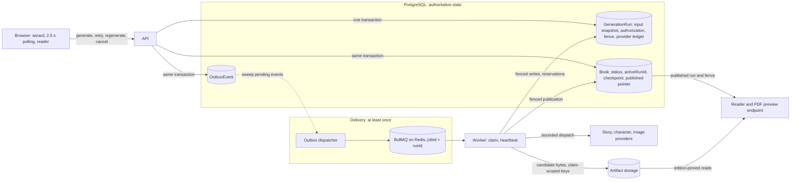
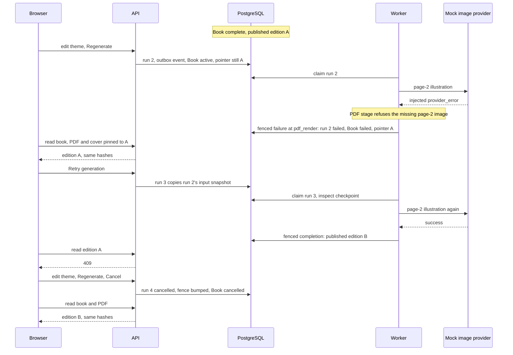

# Engineering case study: StoryMe book generation

Claims link to code and, where one exists, a test. A linked test is coverage, not a result;
executed runs are in [section 8](#8-evidence-and-limitations).

## 1. Product and topology

A parent enters a child's name, age, language (`en`, `ru`, `pl`), theme and page count; a
queued pipeline produces a character, story, illustrations, layout and PDF. The work calls
paid providers, can take minutes, and can fail part-way. The
[interactive stories](interactive-case-study.md) are the opposite: a deterministic engine
applies each choice within one request, with no queue, worker or provider at runtime.

The backend is one NestJS modular monolith with two entrypoints:
[main.ts](../apps/api/src/main.ts) serves HTTP; [worker.ts](../apps/api/src/worker.ts) boots the
same modules without HTTP and consumes BullMQ. `ENABLE_GENERATION_WORKER=true` embeds the
consumer in the API process, which is the local-demo topology
([demo-local.mjs](../scripts/demo-local.mjs)). The split is covered by module tests only
([Worker process separation](../apps/api/docs/local-generation-pipeline.md#worker-process-separation)).

## 2. Architecture

- **Authoritative state:** `Book`, `GenerationRun`, `OutboxEvent`. Ownership, budget and
  publication are decided here.
- **Delivery:** dispatcher and BullMQ. A lost job delays work; it cannot change what is
  published.
- **Candidates:** bytes under `runs/{runId}/claims/{fencingVersion}/` and the
  `Book.generationCheckpoint` JSON. Readers never see them.
- **Published pointers:** `Book.publishedRunId` and `publishedRunFencingVersion` name the one
  claim the reader serves.

## 3. Scheduling and execution guarantees

**Scheduling.** Admission runs first: a Redis-backed global circuit, per-user concurrency and
window counts from `GenerationRun`, and the estimate against hard limits. These are
check-then-act, not reservations. One transaction in
[book-generation.service.ts](../apps/api/src/books/book-generation.service.ts)
(`createRunAndSchedule`) then inserts the run with its immutable input snapshot, input hash,
execution authorization and queue deadline; debits a credit in demo mode; moves the Book from
its expected status with a compare-and-set update; and inserts an `OutboxEvent`. A partial
unique index permits one queued or running run per book
([migration](../apps/api/prisma/migrations/20260714163934_phase2a_generation_run_outbox/migration.sql));
a violation becomes `409`.

**Delivery.** [outbox-dispatcher.service.ts](../apps/api/src/outbox/outbox-dispatcher.service.ts)
sweeps about every 2 s in every process, publishes pending events to BullMQ, then marks them
dispatched. A crash in between causes a resend, which the `runId` job id makes a no-op while
the job exists. Delivery is at least once, with no dead-letter state or backoff.

**Claim, fence, heartbeat.** One `claim` transaction in
[generation-run.service.ts](../apps/api/src/agent/generation-run.service.ts) refuses terminal
or queue-expired runs, increments `fencingVersion`, stores BullMQ's per-delivery token, and
turns any `reserved` or `dispatch_intent` provider operation into `unknown`. Every later run or
Book write is conditioned on the fence. The 5 s heartbeat also checks the token; when rejected,
the worker aborts a signal that reaches provider calls and retry sleeps.

**Terminal transitions.** In
[generation-run-coordinator.service.ts](../apps/api/src/agent/generation-run-coordinator.service.ts),
the fenced run update, the Book update conditioned on `activeRunId`, agent logs and any refund
commit together. Cancellation is one transaction too: run `cancelled` with its fence bumped,
Book `cancelled`, pending outbox events suppressed, charge refunded.

**Recovery.** A leader elected through a lease row fails expired-lease and overdue queued runs
through the same fenced transition. It skips runs BullMQ still reports pending, unless their
queue deadline has passed
([generation-run-recovery.service.ts](../apps/api/src/agent/generation-run-recovery.service.ts)).
It never resumes work; the user retries.

**Boundaries.** Scheduling, claims, fenced writes, publication and cancellation are atomic in
PostgreSQL. Queue publication, provider HTTP and storage writes are not. A superseded worker
cannot change database state, but a storage write it already started can land as an orphan
under its own claim
([known limitations](../apps/api/docs/local-generation-pipeline.md#known-limitations-explicit-not-yet-built)).
Provider execution is not exactly once.

## 4. Checkpoints and publication

`Book.generationCheckpoint` holds candidate work: character profile, accepted story, layout,
and a manifest of stored images with SHA-256 hashes, tagged with input hash, compatibility
fingerprint, run and fence ([generation-checkpoint.ts](../apps/api/src/agent/generation-checkpoint.ts)).
The fingerprint hashes prompt versions, providers and models
([generation-compatibility-fingerprint.ts](../apps/api/src/agent/generation-compatibility-fingerprint.ts)).

Reuse requires both hashes to match, and an image must decode and match its manifest hash. It
is then copied into the new claim's namespace, not referenced in place
([generation-resume.service.ts](../apps/api/src/agent/generation-resume.service.ts)). The
estimate and the worker share this inspection, so a retry is authorized only for remaining work.

**Retry** copies the failed run's input snapshot, so its checkpoint can match. **Regenerate**
snapshots the current fields; after an edit the hash differs and nothing is reused. Reuse
follows these identities, not the request type.

**Publication.** [generation-publication.service.ts](../apps/api/src/agent/generation-publication.service.ts)
lays out pages, checkpoints the candidate and renders the PDF under the claim's key. Only the
coordinator's successful `completeRun` writes reader fields and moves the pointer to
`(runId, fencingVersion)`; failure and cancellation change only status, error fields and
`activeRunId`. So the previous edition is replaced only by a successful publication. Readers pin
`publishedEdition`; a replaced edition gets `409`.

## 5. Failure sequence: the recovery journey

[storyme.recovery.spec.ts](../apps/web/e2e/storyme.recovery.spec.ts) asserts this against the
real API, worker, PostgreSQL and Redis, with a deterministic mock fault configured in
[playwright.recovery.config.ts](../apps/web/playwright.recovery.config.ts); its assertions are
listed in [Evidence checked](recovery-demo.md#evidence-checked). It shows provider-failure
handling, retry and cancellation, not recovery from a worker crash, lost Redis job or database
outage.

## 6. AI engineering and limits

- **Provider boundaries.** Story, character and image providers are injected interfaces, each
  with a mock and an OpenAI implementation.
- **Output validation.** The OpenAI story and character adapters request strict structured
  outputs; every story result passes local schema and business checks
  ([validator](../apps/api/src/agent/story-generation-result-validator.ts)), and a deterministic
  quality gate runs before any image request
  ([story-quality-gate.ts](../apps/api/src/agent/story-quality-gate.ts)).
- **Bounded repair.** Opt-in (`STORY_REPAIR_ENABLED=false` by default), at most one call,
  included in the estimate ([repair stage](../apps/api/src/agent/story-quality-repair.stage.ts)).
- **Durable dispatch limits.** The run stores its authorization: estimate, per-category
  operations, attempts per operation, maximum dispatches, estimated exposure
  ([generation-execution-policy.ts](../apps/api/src/agent/generation-execution-policy.ts)). The
  worker rejects configuration drift and records a `dispatch_intent` before every HTTP attempt,
  in a transaction that rechecks the caps
  ([generation-execution.service.ts](../apps/api/src/agent/generation-execution.service.ts)).
- **Unknown remote outcomes.** Timeouts, network errors and cancellation are `unknown`, never
  failed or free; a superseded intent becomes `unknown_remote_outcome` and still counts
  ([generation-provider-telemetry.ts](../apps/api/src/agent/generation-provider-telemetry.ts)).
  A provider may continue, or charge, after cancellation.

Three quantities stay separate. The **estimate** is planned calls times configured per-call USD
assumptions, not a quote. **Observed usage** is the run ledger: dispatches, HTTP attempts, and
tokens when reported; no invoiced dollars. The **charge** is one credit per generation in demo
mode, refunded idempotently on failure or cancellation; home mode charges nothing. None is
reconciled with a provider invoice.

Every demonstration used deterministic mock providers. **Real-model quality, error rates and
cost are unmeasured.**

## 7. Trade-offs

| Decision                                   | Benefit                                                                     | Cost or limit                                                                                        |
| ------------------------------------------ | --------------------------------------------------------------------------- | ---------------------------------------------------------------------------------------------------- |
| PostgreSQL run and outbox, Redis delivery  | A commit followed by a crash cannot lose the job; the database is the truth | Two stores to operate; up to one sweep of latency; at-least-once delivery; no dead-letter or backoff |
| Fence on every database write              | A superseded worker cannot overwrite run or Book state                      | Does not stop that worker's in-flight storage writes or remote calls; orphans need separate cleanup  |
| Persisted checkpoints with identity checks | A retry pays only for missing work, and the estimate reflects that          | Any prompt, model or provider change invalidates all reuse; checkpoint JSON lives on the Book row    |
| Fenced publication pointer                 | A failed or cancelled regeneration never damages the readable book          | Candidate and published bytes coexist; clients must handle `409` on an edition change                |
| Polling every 2.5 s                        | No socket infrastructure; shows only stages the worker durably entered      | Up to 2.5 s of status lag; request load grows with open detail pages                                 |
| Local storage by default, S3/R2 optional   | No setup, and normal tests never touch the network                          | Local drivers write under `apps/api/tmp`, so a separate worker host needs shared storage             |

## 8. Evidence and limitations

### Implementation and test coverage in source

| Guarantee                                           | Tests                                                                                                                                                                                                                     |
| --------------------------------------------------- | ------------------------------------------------------------------------------------------------------------------------------------------------------------------------------------------------------------------------- |
| Run, charge, Book CAS and outbox in one transaction | [book-generation.service.spec.ts](../apps/api/src/books/book-generation.service.spec.ts)                                                                                                                                  |
| Re-swept outbox event causes no duplicate work      | [outbox-redelivery.integration.spec.ts](../apps/api/test/integration/outbox-redelivery.integration.spec.ts)                                                                                                               |
| Stale fence or delivery token is rejected           | [generation-fencing.integration.spec.ts](../apps/api/test/integration/generation-fencing.integration.spec.ts), [stalled redelivery](../apps/api/test/integration/generation-queue-stalled-redelivery.integration.spec.ts) |
| Cancellation races resolve to one outcome           | [generation-cancellation.integration.spec.ts](../apps/api/test/integration/generation-cancellation.integration.spec.ts)                                                                                                   |
| Old edition survives a failed regeneration          | [generation-editions.integration.spec.ts](../apps/api/test/integration/generation-editions.integration.spec.ts), [pdf-publication.integration.spec.ts](../apps/api/test/integration/pdf-publication.integration.spec.ts)  |
| Dispatch caps hold under concurrency                | [generation-execution-acceptance.integration.spec.ts](../apps/api/test/integration/generation-execution-acceptance.integration.spec.ts)                                                                                   |
| Recovery skips BullMQ-pending runs before deadline  | [generation-run-recovery.service.spec.ts](../apps/api/src/agent/generation-run-recovery.service.spec.ts)                                                                                                                  |

These specs simulate takeover and redelivery inside one test process; no real process is
killed.

### Executed demonstrations

1. **Hosted CI** on `f50c9c3` (PR #25, merged as `fd870ef`): the Checks and Isolated
   integration jobs passed, the latter with 27 files and 324 tests
   ([interactive-verification.md §24](interactive-verification.md#24-follow-up-phase-1613-hosted-ci-result-for-the-script-test-repair-added-after-phase-1613)).
   No hosted result is recorded for closeout commits `1626e7a`..`7778431`.
2. **Recovery journey**, 2026-10-27, change committed as `8c027a7`: one pass on a disposable
   local stack, per the closeout work notes; no run record is committed. Reproduce:
   [recovery-demo.md](recovery-demo.md).
3. **Showcase capture**, 2026-10-27, `afd5d6e` plus the changes committed as `7778431`: two
   complete mock-provider runs, 35 of 35 validations each. Reproduce:
   [demo-showcase.md](demo-showcase.md); outputs are not committed.
4. **Dashboard navigation** (closeout step 4): its browser journey was not run when added; the
   only evidence was a throwaway harness with mocked API responses.

**Diagnostics ambiguity.** In `GET /books/:id/generation-diagnostics`, `imageFailures` and
`resume` come from `Book.imageGenerationResult`, the published edition, so after a failed
regeneration they still describe the previous success. `providerUsage` reads the newest run's
ledger but falls back to that Book snapshot when the run has none, such as a run cancelled while
queued ([generation-diagnostics.ts](../apps/api/src/books/generation-diagnostics.ts#L420)).
Fallback data is not evidence of the newest run's work; only ledger data carries
`actualDispatches` ([details](recovery-demo.md#published-diagnostics-vs-current-run-telemetry)).

**Unverified.** Any deployment; separate API and worker processes on live infrastructure;
S3/R2 in this flow; scale; real-provider quality, errors and cost; recovery from a real worker
crash, Redis loss or database outage; what a regeneration with unchanged inputs reuses.

## 9. Interview narration

### 60 seconds

"StoryMe turns a child's details into an illustrated PDF through a queued
pipeline that calls paid providers. PostgreSQL is the source of truth: one transaction creates
the run with its frozen input and budget, moves the book, and writes an outbox event, which a
dispatcher delivers to BullMQ at least once. A worker claims the run by bumping a fencing
version that every database write checks, so a superseded worker cannot corrupt state.
Checkpoints carry input and pipeline hashes, so a retry pays only for missing work. Publication
moves an edition pointer in one fenced transaction, so a failed or cancelled regeneration
leaves the old book readable. Provider calls are reserved durably before dispatch, and an
interrupted call counts as unknown, not free. All of this was demonstrated with mock providers;
real-model quality and production scale are unmeasured."

### 3-minute outline

1. Problem: slow, partly failing, paid work behind a form (15 s).
2. Topology: one monolith, API and worker entrypoints, embedded worker locally (20 s).
3. Scheduling transaction and outbox; atomic versus cross-system steps (35 s).
4. Claims, fencing, heartbeat, recovery; why not exactly once (35 s).
5. Checkpoints, publication, retry versus regenerate (30 s).
6. The recovery journey as the worked example (25 s).
7. AI limits: validation, bounded repair, durable budgets, three cost quantities (25 s).
8. Evidence tiers and what is unverified (15 s).
