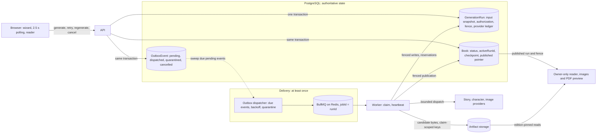
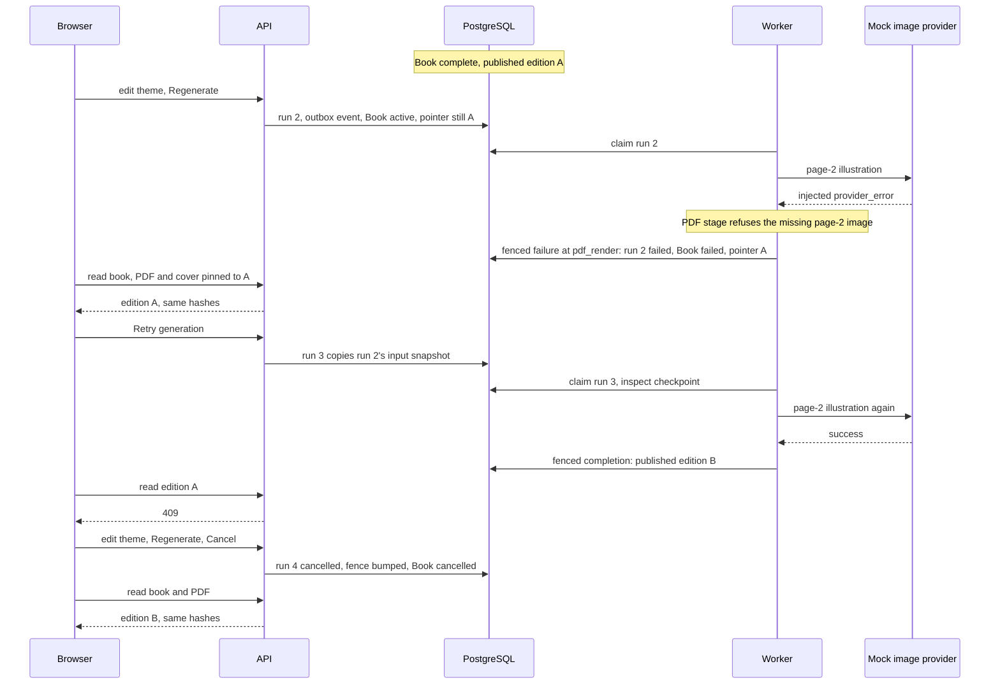

# Engineering case study: StoryMe book generation

Claims link to code and, where one exists, a test. A linked test is coverage, not a result;
executed runs are summarized in [section 9](#9-evidence-and-limitations), and the latest fresh
results are in [PORTFOLIO_RELEASE.md](PORTFOLIO_RELEASE.md#fresh-verification).

## 1. Product and topology

A parent enters a child's name, age (1–12), language (`en`, `ru`, `pl`), theme and page count; a
queued pipeline produces a character, story, illustrations, layout and PDF. The work calls
paid providers, can take minutes, and can fail part-way. StoryMe creates only these
personalized children's books; an earlier branching-story reader was retired in November 2026
([details](CURRENT_PRODUCT.md#retired-interactive-stories)).

The backend is one NestJS modular monolith with two entrypoints:
[main.ts](../apps/api/src/main.ts) serves HTTP; [worker.ts](../apps/api/src/worker.ts) boots the
same modules without HTTP and consumes BullMQ. `ENABLE_GENERATION_WORKER=true` embeds the
consumer in the API process, which is the local-demo topology
([demo-local.mjs](../scripts/demo-local.mjs)).

The split topology is exercised end to end by the production-container release smoke
([section 8](#8-production-container-verification)): the API and a separate worker run as two
containers from the same image, and the worker alone publishes the book. Module tests cover the
wiring ([Worker process separation](../apps/api/docs/local-generation-pipeline.md#worker-process-separation)).
That smoke runs on local disposable infrastructure, not on hosted infrastructure.

## 2. Architecture

- **Authoritative state:** `Book`, `GenerationRun`, `OutboxEvent`. Ownership, budget and
  publication are decided here.
- **Delivery:** dispatcher and BullMQ. The outbox row retains the committed scheduling intent
  until it is published. A Redis job lost after that is not re-sent: recovery fails the run, and
  the user retries. Either way, delivery cannot change what is published.
- **Candidates:** bytes under `runs/{runId}/claims/{fencingVersion}/` and the
  `Book.generationCheckpoint` JSON. Readers never see them.
- **Published pointers:** `Book.publishedRunId` and `publishedRunFencingVersion` name the one
  claim the reader serves. Database `CHECK` constraints reject half-set pointer pairs
  ([test](../apps/api/test/integration/generation-artifact-namespace-pointers.integration.spec.ts)).

## 3. Scheduling and delivery

**Admission and scheduling.** Admission runs first: a Redis-backed global circuit, per-user
concurrency and window counts from `GenerationRun`, and the estimate against hard limits. These
are check-then-act, not reservations. One transaction in
[book-generation.service.ts](../apps/api/src/books/book-generation.service.ts)
(`createRunAndSchedule`) then inserts the run with its immutable input snapshot, input hash,
execution authorization and queue deadline; debits a credit in demo mode; moves the Book from
its expected status with a compare-and-set update; and inserts an `OutboxEvent`. A partial
unique index permits one queued or running run per book
([migration](../apps/api/prisma/migrations/20260714163934_phase2a_generation_run_outbox/migration.sql));
a violation becomes `409`. Page-image revisions and permanent deletions write their own outbox
events the same way.

**At-least-once delivery.** [outbox-dispatcher.service.ts](../apps/api/src/outbox/outbox-dispatcher.service.ts)
runs in every API and worker process, by default every 2 s with a batch of 20. It selects only
`pending` events whose `nextAttemptAt` is due, publishes each to BullMQ with the aggregate's id
as the job id, then conditionally marks the row `dispatched`
([outbox.service.ts](../apps/api/src/outbox/outbox.service.ts)). A crash or failed
acknowledgement between publish and mark causes a resend, which the job id makes a no-op while
the job exists. Worker fencing remains necessary because delivery is at least once.

**Retry backoff and quarantine.** The dispatcher validates each envelope before publishing it:

| Outcome                                                    | Durable result                                                                  |
| ---------------------------------------------------------- | ------------------------------------------------------------------------------- |
| Unknown `aggregateType`                                    | `quarantined`, reason `unknown_aggregate`; never published                      |
| Null, primitive or array payload; missing book or wrong id | `quarantined`, reason `invalid_payload`; never published                        |
| Queue publish or acknowledgement fails                     | stays `pending`; `attempts` + 1; `nextAttemptAt` = now + `min(5 min, 2 s × 2ⁿ)` |
| A cancellation, dispatch or quarantine already won the row | the conditional update changes nothing                                          |

One poison or failing event cannot abort the batch, and the attempt counter is updated with a
compare-and-set on the observed value, so concurrent sweeps count one failure once. The retry
**delay** is bounded, at five minutes; the retry **count** is deliberately not, so a long Redis
outage never discards authorized work. A run can still be failed by recovery while its event
waits. Quarantine preserves evidence; it never repairs, refunds or re-authorizes anything.
Operators inspect it with SQL ([outbox-operations.md](outbox-operations.md)).
Coverage: [outbox-dispatcher.service.spec.ts](../apps/api/src/outbox/outbox-dispatcher.service.spec.ts)
and, against real PostgreSQL and Redis,
[outbox-isolation.integration.spec.ts](../apps/api/test/integration/outbox-isolation.integration.spec.ts)
(a full poison batch, a full failing batch, concurrent failures) and
[outbox-redelivery.integration.spec.ts](../apps/api/test/integration/outbox-redelivery.integration.spec.ts).

The outbox protects the gap between commit and publication, not Redis itself: if Redis later
loses a dispatched job, nothing re-sends it, and the queued run is failed by recovery once it is
older than `GENERATION_RUN_QUEUED_STALE_MS`, 5 minutes by default.

## 4. Execution: claims, fencing and cancellation

**Claim, fence, heartbeat.** One `claim` transaction in
[generation-run.service.ts](../apps/api/src/agent/generation-run.service.ts) refuses terminal
or queue-expired runs, increments `fencingVersion`, stores BullMQ's per-delivery token, and
turns any `reserved` or `dispatch_intent` provider operation into `unknown`. Every later run or
Book write is conditioned on the fence. The 5 s heartbeat also checks the token; when rejected,
the worker aborts a signal that reaches provider calls and retry sleeps
([generation-fencing.integration.spec.ts](../apps/api/test/integration/generation-fencing.integration.spec.ts),
[stalled redelivery](../apps/api/test/integration/generation-queue-stalled-redelivery.integration.spec.ts)).

**Terminal transitions.** In
[generation-run-coordinator.service.ts](../apps/api/src/agent/generation-run-coordinator.service.ts),
the fenced run update, the Book update conditioned on `activeRunId`, agent logs and any refund
commit together.

**Cancellation** is one transaction: run `cancelled` with its fence bumped, Book `cancelled`,
pending outbox events marked `cancelled`, charge refunded. The bumped fence makes the current
worker's next heartbeat or write fail, and a cancelled run cannot be claimed again. When
cancellation and completion race, exactly one wins
([generation-cancellation.integration.spec.ts](../apps/api/test/integration/generation-cancellation.integration.spec.ts)).
A provider call already in flight may still complete, or charge, remotely.

**Recovery.** A leader elected through a lease row fails expired-lease and overdue queued runs
through the same fenced transition. It skips runs BullMQ still reports pending, unless their
queue deadline has passed
([generation-run-recovery.service.ts](../apps/api/src/agent/generation-run-recovery.service.ts),
[test](../apps/api/src/agent/generation-run-recovery.service.spec.ts)). It never resumes work;
the user retries.

**Boundaries.** Scheduling, claims, fenced writes, publication and cancellation are atomic in
PostgreSQL. Queue publication, provider HTTP and storage writes are not. A superseded worker
cannot change database state, but a storage write it already started can land as an orphan
under its own claim
([known limitations](../apps/api/docs/local-generation-pipeline.md#known-limitations-explicit-not-yet-built)).
Provider execution is not exactly once.

## 5. Candidates, editions and diagnostics

**Candidate artifacts.** `Book.generationCheckpoint` holds candidate work: character profile,
accepted story, layout, and a manifest of stored images with SHA-256 hashes, tagged with input
hash, compatibility fingerprint, run and fence
([generation-checkpoint.ts](../apps/api/src/agent/generation-checkpoint.ts)). The fingerprint
hashes prompt versions, providers and models
([generation-compatibility-fingerprint.ts](../apps/api/src/agent/generation-compatibility-fingerprint.ts)).
Candidate bytes are written under the claim's own key prefix and are never served.

Reuse requires both hashes to match, and an image must decode and match its manifest hash. It is
then copied into the new claim's namespace, not referenced in place
([generation-resume.service.ts](../apps/api/src/agent/generation-resume.service.ts)). The
estimate and the worker share this inspection, so only remaining work is estimated and
authorized. This is not a billing guarantee: a call from an earlier run whose remote outcome is
unknown may still have incurred a provider charge. **Retry** copies the failed run's input
snapshot, so its checkpoint can match; **regenerate** snapshots the current fields, so after an
edit nothing is reused.

**Atomic publication.** [generation-publication.service.ts](../apps/api/src/agent/generation-publication.service.ts)
lays out pages, checkpoints the candidate and renders the PDF under the claim's key. Only the
coordinator's successful `completeRun` writes reader fields and moves the pointer to
`(runId, fencingVersion)`, in one fenced transaction. Failure and cancellation change only
status, error fields and `activeRunId`.

**Publication survives a failed regeneration.** Because only a successful completion moves the
pointer, the previous edition's text, images, page versions and PDF stay readable when a
regeneration fails or is cancelled
([generation-editions.integration.spec.ts](../apps/api/test/integration/generation-editions.integration.spec.ts),
[pdf-publication.integration.spec.ts](../apps/api/test/integration/pdf-publication.integration.spec.ts)).
Readers pin `publishedEdition`; once a newer edition replaces it, requests for the old one get
`409 PUBLISHED_EDITION_CHANGED`.

**Published edition versus latest attempt.** `GET /books/:id/generation-diagnostics` reports
two separate projections. `publishedEdition` comes only from the published Book columns and the
run `publishedRunId` names; the latest generation attempt comes only from the newest
`GenerationRun` and its own ledger. A run without a ledger reports its usage as unavailable
instead of borrowing the published edition's, and all fields are read in one database snapshot
([generation-diagnostics.ts](../apps/api/src/books/generation-diagnostics.ts),
[generation-diagnostics-provenance.integration.spec.ts](../apps/api/test/integration/generation-diagnostics-provenance.integration.spec.ts),
[details](recovery-demo.md#published-edition-vs-latest-generation-attempt)). An earlier version
mixed the two sources.

**Authenticated artifact access.** Every `/books` route passes the auth guard, and images
(`GET /api/books/:id/images/:imageId`) and the PDF (`GET /api/books/:id/pdf/preview`) are
loaded only through an owner-scoped lookup
([book-asset.service.ts](../apps/api/src/books/book-asset.service.ts),
[books.controller.ts](../apps/api/src/books/books.controller.ts)). They resolve keys from the
published pointer, never from a candidate namespace, and images are sent with
`Cache-Control: private, no-store` and `nosniff`. Another user's book is indistinguishable from
a missing one. Coverage: the
[image](../apps/api/src/books/books.controller.published-image-http.spec.ts) and
[PDF](../apps/api/src/books/books.controller.pdf-preview-http.spec.ts) HTTP specs, and the
release smoke's anonymous `401` and cross-account `403`/`404` checks.

## 6. Failure sequence: the recovery journey

[storyme.recovery.spec.ts](../apps/web/e2e/storyme.recovery.spec.ts) asserts this against the
real API, worker, PostgreSQL and Redis, with a deterministic mock fault configured in
[playwright.recovery.config.ts](../apps/web/playwright.recovery.config.ts); its assertions are
listed in [Evidence checked](recovery-demo.md#evidence-checked). It shows provider-failure
handling, retry and cancellation, not recovery from a worker crash, lost Redis job or database
outage.

## 7. AI engineering and limits

- **Provider boundaries.** Story, character and image providers are injected interfaces, each
  with a deterministic mock (the default) and an OpenAI implementation that is used only when
  explicitly configured with a key.
- **Output validation.** The OpenAI story and character adapters request strict structured
  outputs; every story result passes local schema and business checks
  ([validator](../apps/api/src/agent/story-generation-result-validator.ts)).
- **Deterministic quality checks.** A quality gate runs before any image request: page count,
  protagonist and personalization, ending, repetition, duplicate pages, markup or URLs
  ([story-quality-gate.ts](../apps/api/src/agent/story-quality-gate.ts)). The offline evaluation
  (`pnpm eval:story:offline`) checks it against fixed good and malformed cases with no API calls.
- **Optional bounded repair.** Opt-in (`STORY_REPAIR_ENABLED=false` by default), at most one
  call, included in the estimate ([repair stage](../apps/api/src/agent/story-quality-repair.stage.ts)).
- **Bounded AI work.** The run stores its authorization: estimate, per-category operations,
  attempts per operation, maximum dispatches, estimated exposure
  ([generation-execution-policy.ts](../apps/api/src/agent/generation-execution-policy.ts)). The
  worker rejects configuration drift and records a `dispatch_intent` before every HTTP attempt,
  in a transaction that rechecks the caps
  ([generation-execution.service.ts](../apps/api/src/agent/generation-execution.service.ts),
  [concurrency acceptance test](../apps/api/test/integration/generation-execution-acceptance.integration.spec.ts)).
- **Unknown remote outcomes.** Timeouts, network errors and cancellation are `unknown`, never
  failed or free; a superseded intent becomes `unknown_remote_outcome` and still counts
  ([generation-provider-telemetry.ts](../apps/api/src/agent/generation-provider-telemetry.ts)).

Three quantities stay separate. The **estimate** is planned calls times configured per-call USD
assumptions, not a quote. **Observed usage** is the run ledger: dispatches, HTTP attempts, and
tokens when reported; no invoiced dollars. The **charge** is one credit per generation in demo
mode, refunded idempotently on failure or cancellation; Home mode charges nothing. None is
reconciled with a provider invoice.

The quality checks are structural heuristics. They do not establish that a story is good, safe
in every respect, or that illustrations resemble the child or each other. Every demonstration
used deterministic mock providers. **Real-model quality, error rates and cost are unmeasured.**

## 8. Production-container verification

[release-smoke.mjs](../scripts/release-smoke.mjs) (`pnpm smoke:release`,
[guide](release-smoke.md)) builds the API image and, in a fresh owned Compose project with
generated credentials, runs disposable PostgreSQL, Redis and a SeaweedFS S3 gateway. The image
checks the database identity and applies every migration; then the API (`node dist/main`, no
embedded worker) and later a separate worker (`node dist/worker`) start, both non-root with
`NODE_ENV=production` and the `s3` storage drivers.

One synthetic four-page book goes through real registration and login, a mock-only estimate
gate, scheduling while no worker runs (outbox row `dispatched`, job waiting in BullMQ, progress
`queued`), worker publication, PNG and PDF structural validation, anonymous and cross-account
denial, and a restart of both application containers after which the edition and every
artifact's SHA-256 are unchanged. Cleanup is verified by label. The orchestration's failure and
cleanup paths are unit-tested in [release-smoke.test.mjs](../scripts/release-smoke.test.mjs);
CI runs the smoke on the image its container job builds.

It proves the image boots both roles and that the outbox → Redis → separate worker → S3 →
authenticated read path works with production settings. It does not prove real S3/R2, hosted
ingress or TLS, the web app's cookie flow, real providers, or any deployment.

## 9. Evidence and limitations

### Implementation and test coverage in source

| Guarantee                                           | Tests                                                                                                                                                                                                                     |
| --------------------------------------------------- | ------------------------------------------------------------------------------------------------------------------------------------------------------------------------------------------------------------------------- |
| Run, charge, Book CAS and outbox in one transaction | [book-generation.service.spec.ts](../apps/api/src/books/book-generation.service.spec.ts)                                                                                                                                  |
| Re-swept outbox event causes no duplicate work      | [outbox-redelivery.integration.spec.ts](../apps/api/test/integration/outbox-redelivery.integration.spec.ts)                                                                                                               |
| Poison events quarantined, failures back off        | [outbox-isolation.integration.spec.ts](../apps/api/test/integration/outbox-isolation.integration.spec.ts), [outbox-dispatcher.service.spec.ts](../apps/api/src/outbox/outbox-dispatcher.service.spec.ts)                  |
| Stale fence or delivery token is rejected           | [generation-fencing.integration.spec.ts](../apps/api/test/integration/generation-fencing.integration.spec.ts), [stalled redelivery](../apps/api/test/integration/generation-queue-stalled-redelivery.integration.spec.ts) |
| Cancellation races resolve to one outcome           | [generation-cancellation.integration.spec.ts](../apps/api/test/integration/generation-cancellation.integration.spec.ts)                                                                                                   |
| Old edition survives a failed regeneration          | [generation-editions.integration.spec.ts](../apps/api/test/integration/generation-editions.integration.spec.ts), [pdf-publication.integration.spec.ts](../apps/api/test/integration/pdf-publication.integration.spec.ts)  |
| Published edition and latest attempt stay separate  | [generation-diagnostics-provenance.integration.spec.ts](../apps/api/test/integration/generation-diagnostics-provenance.integration.spec.ts)                                                                               |
| Dispatch caps hold under concurrency                | [generation-execution-acceptance.integration.spec.ts](../apps/api/test/integration/generation-execution-acceptance.integration.spec.ts)                                                                                   |
| Recovery skips BullMQ-pending runs before deadline  | [generation-run-recovery.service.spec.ts](../apps/api/src/agent/generation-run-recovery.service.spec.ts)                                                                                                                  |
| Owner-only artifact reads, edition pinning          | [published-image HTTP spec](../apps/api/src/books/books.controller.published-image-http.spec.ts), [PDF preview HTTP spec](../apps/api/src/books/books.controller.pdf-preview-http.spec.ts)                                |

The integration specs simulate takeover and redelivery inside one test process; no real process
is killed. The release smoke restarts containers cleanly; it does not kill a worker mid-run.

### Executed evidence

The final verification matrix, with commands, counts, revision and environment, is in
[PORTFOLIO_RELEASE.md](PORTFOLIO_RELEASE.md#fresh-verification). It keeps local tests, local
production containers, the curated sample, mock-provider generation, hosted CI and
real-provider/cloud evidence in separate categories. Earlier runs are recorded, as they were, in
[PAUSE_HANDOFF.md](PAUSE_HANDOFF.md) and [PROJECT_CLOSEOUT.md](PROJECT_CLOSEOUT.md); they
describe earlier repository states.

### Trade-offs

| Decision                                   | Benefit                                                                                    | Cost or limit                                                                                                                                          |
| ------------------------------------------ | ------------------------------------------------------------------------------------------ | ------------------------------------------------------------------------------------------------------------------------------------------------------ |
| PostgreSQL run and outbox, Redis delivery  | Committed scheduling intent survives a crash before publication; the database is the truth | Two stores to operate; up to one sweep of latency; at-least-once delivery; a job Redis loses after dispatch is not re-sent (recovery fails the run)    |
| Unlimited outbox retries, capped backoff   | A long Redis outage never discards authorized work; failing events stop blocking due ones  | No retry-exhaustion state; a waiting event can outlive its run's recovery deadline; quarantine needs manual, reviewed handling                         |
| Fence on every database write              | A superseded worker cannot overwrite run or Book state                                     | Does not stop that worker's in-flight storage writes or remote calls; orphans need separate cleanup                                                    |
| Persisted checkpoints with identity checks | Compatible, validated artifacts can be reused; only remaining work is estimated            | Any prompt, model or provider change invalidates all reuse; checkpoint JSON lives on the Book row; unknown remote outcomes may still have been charged |
| Fenced publication pointer                 | A failed or cancelled regeneration never damages the readable book                         | Candidate and published bytes coexist; clients must handle `409` on an edition change                                                                  |
| Deterministic quality gate before images   | Cheap, offline-testable rejection of malformed stories before the costly image stage       | Heuristic only; says nothing about literary quality, full content safety or visual consistency                                                         |
| Polling every 2.5 s                        | No socket infrastructure; shows only stages the worker durably entered                     | Up to 2.5 s of status lag; request load grows with open detail pages                                                                                   |
| Local storage by default, S3 optional      | No setup, and normal tests never touch the network                                         | A separate worker host needs shared (S3) storage; S3 is verified only against a local emulator                                                         |

### Unverified

Any deployment; API and worker on hosted infrastructure; real AWS S3 or Cloudflare R2 in this
flow; scale and load; real-provider quality, errors and cost; recovery from a killed worker,
Redis data loss or a database outage; exactly-once provider execution (not provided by
design); what a regeneration with unchanged inputs reuses.

## 10. Interview narration

### 60 seconds

"StoryMe turns a child's details into an illustrated PDF through a queued pipeline that calls
paid providers. PostgreSQL is the source of truth: one transaction creates the run with its
frozen input and budget, moves the book, and writes an outbox event. A dispatcher delivers that
event to BullMQ at least once, backs off on transport failures and quarantines malformed events
so they cannot block the queue. A worker claims the run by bumping a fencing version that every
database write checks, so a superseded or cancelled worker cannot corrupt state. Candidate
artifacts live under the claim's own keys; publication moves an edition pointer in one fenced
transaction, so a failed or cancelled regeneration leaves the old book readable, and only the
owner can read it. Provider calls are reserved durably before dispatch, and an interrupted call
counts as unknown, not free. A browser journey shows the publication guarantee with a mock
provider failure, a retry and a cancellation, and a release smoke runs the API and a separate
worker as production containers against local S3 emulation. Real-model quality and production
operation are unmeasured."

### 3-minute outline

1. Problem: slow, partly failing, paid work behind a form (15 s).
2. Topology: one monolith, API and worker entrypoints, embedded worker locally (15 s).
3. Scheduling transaction, outbox, backoff and quarantine; atomic versus cross-system steps (35 s).
4. Claims, fencing, cancellation, recovery; why not exactly once (30 s).
5. Candidates, atomic publication, diagnostics provenance, owner-only reads (30 s).
6. The recovery journey and the release smoke, and what they do not show (25 s).
7. AI limits: validation, quality gate, bounded repair, durable budgets, three cost quantities (20 s).
8. Evidence tiers and what is unverified (10 s).
