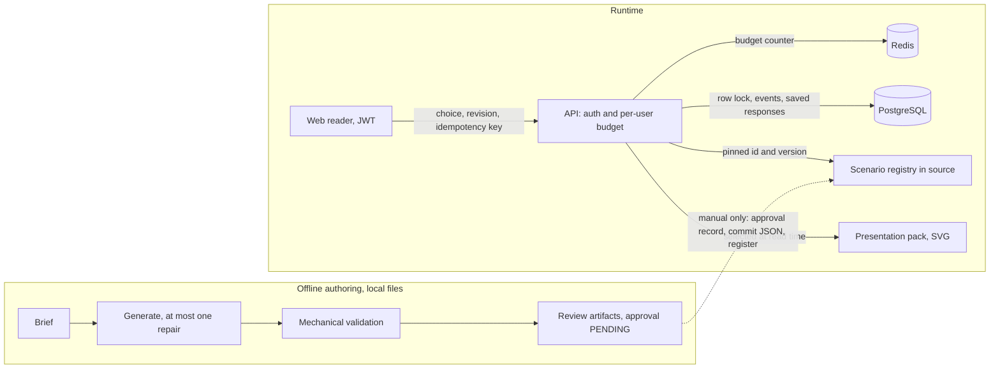
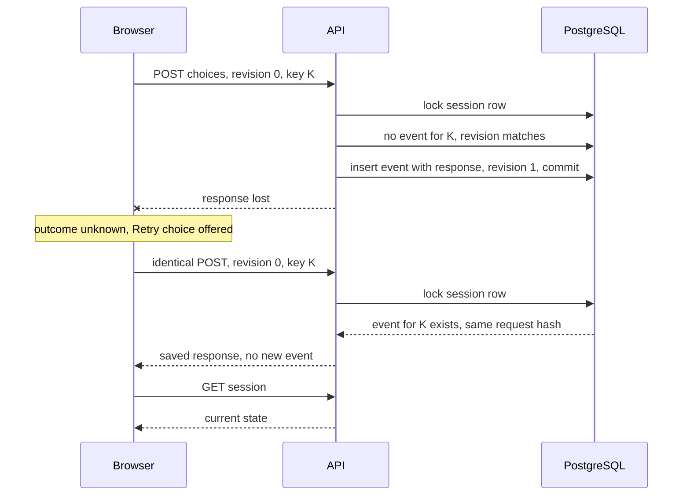

# Engineering case study: StoryMe interactive stories

Claims link to the implementing file or test where one exists. Anything that is only configured, or
not verified, is labelled as such.

## 1. Product and boundaries

A signed-in reader plays a branching detective story in the browser. A deterministic engine
validates each choice, appends one event, and returns a public view; no language model runs during
play. A separate, offline workflow can draft further scenarios with a model, validate them
mechanically, and stop at review artifacts on disk.

This is distinct from the personalized-book pipeline in the same repository, which uses a queue, a
worker and image/PDF providers. The interactive product shares only accounts, the API process and
the web app with it ([CURRENT_PRODUCT.md](CURRENT_PRODUCT.md#interactive-illustrated-stories)).

## 2. Architecture

The only edge from authoring into the runtime is the dashed one, and no tool walks it. A person
writes a hash-bound approval record, commits the definition as an immutable versioned file, and
registers it in source. The guarded registry
([guarded-registry.ts](../apps/api/src/interactive/publication/guarded-registry.ts)) throws at load
if a definition has no matching approved record, so the application does not start. The sequence is
specified in
[Publication boundary](../apps/api/docs/interactive-authoring.md#publication-boundary-manual-sequence).

Each route has a per-user request budget in Redis. If Redis cannot answer, the guard refuses the
request with `503 RATE_LIMIT_UNAVAILABLE` instead of letting it through
([user-rate-limit.guard.ts](../apps/api/src/rate-limit/user-rate-limit.guard.ts)).

## 3. One reliability example: a lost choice response

The transaction commits, but the browser never learns that. The player is shown an unknown outcome
and may retry; the retry must not create a second event.

**Server ordering** ([commit in interactive.service.ts](../apps/api/src/interactive/interactive.service.ts)):
inside one transaction the session row is locked (`FOR UPDATE`, also rejecting a foreign or removed
session); then the idempotency key is looked up, and a matching request hash returns the stored
response; only then is the revision compared; the choice is validated and the event insert and
revision update commit together. Idempotency is resolved before the revision check on purpose: an
exact retry still succeeds after later choices advanced the session. The same key with a different
choice is `IDEMPOTENCY_KEY_REUSED`. Lock and statement waits are bounded (2 s and 5 s).

**Client discipline** ([use-interactive-reader.ts](../apps/web/src/app/dashboard/interactive/%5BsessionId%5D/use-interactive-reader.ts)):
the reader freezes one command (choice, displayed revision, key) and resends only that exact
command, by explicit **Retry choice**. A saved response to a retry proves the command was recorded;
it is never shown as current state, because it may be older than the session. The reader forces a
refresh and unblocks choices only when the refreshed revision is at least the recorded one. Every
async result is checked against a scope of session id and auth epoch, so a late response from a
previous session, account or logout/login cycle is dropped.

**Why aborting cannot undo a commit.** The 15-second client deadline aborts the browser's wait.
The commit is decided inside PostgreSQL, so an abort means "unknown", not "failed". That is why the
UI offers an identical retry and never a fresh command.

## 4. AI engineering

**Bounded generation.** One generation request; if, and only if, deterministic content validation
fails, at most one repair request with bounded diagnostics. Provider and transport failures stop
the run and never trigger repair
([pipeline.ts](../apps/api/src/interactive/authoring/pipeline.ts)). The OpenAI adapter disables
transport retries so they cannot multiply the budget
([openai-provider.ts](../apps/api/src/interactive/authoring/openai-provider.ts)).

**Mechanical validity is not quality.** Validation proves schema, reachability, no dead ends, usable
choices and that annotated facts are known by their speaker
([validate.ts](../apps/api/src/interactive/authoring/validate.ts)). Fact annotations are assertions
by the author, so a pass means `REVIEW_REQUIRED`: it cannot detect an unannotated spoiler or a
contradiction, and a test shows contradictory prose passing every stage
([review.spec.ts](../apps/api/src/interactive/authoring/review.spec.ts)).

**Offline corpus.** Three hand-authored, scripted, unpublished entries
([corpus](../apps/api/src/interactive/authoring/corpus/index.ts)) cover item gating, knowledge
gating and single-use inventory. Each of the two new entries is run through first-pass success, one
repair, and a wrong brief refused after the bounded repair. This is deterministic regression coverage, not model
evidence.

**Comparison honesty.** The comparison report groups runs only by identical provider, model, prompt
version, schema version and brief hash. Each rate states its denominator (first-pass rate is
passed/evaluated, not passed/runs) and is `null` when that denominator is 0. Token usage is
summed only over requests that reported it; unknown is never zero and no cost is computed
([run-report-aggregate.ts](../apps/api/src/interactive/authoring/run-report-aggregate.ts)).

**Interrupted experiments.** The experiment runner replaces `manifest.json` atomically at each
step, so a killed run leaves its last checkpoint. An entry marked `awaiting_response` has unknown
usage and a `null` budget verdict. A checkpoint write failure stops before the next dispatch
([experiment.ts](../apps/api/src/interactive/authoring/experiment.ts),
[atomic-replace.ts](../apps/api/src/interactive/authoring/atomic-replace.ts)). A read-only inspector
validates the manifest and only the artifacts it references, and an in-progress checkpoint does not
prove a process is alive
([experiment-inspection.ts](../apps/api/src/interactive/authoring/experiment-inspection.ts)).

**No paid experiment has been run. Real-model authoring quality is unverified**, including how
often a real model needs repair.

## 5. Trade-offs

| Decision                      | Benefit                                               | Limitation                                                                    |
| ----------------------------- | ----------------------------------------------------- | ----------------------------------------------------------------------------- |
| Static, versioned publication | A pinned session replays against the exact definition | A new story or a fix needs a commit and deploy; no editor                     |
| Fixed narration templates     | Runtime text cannot diverge from authored templates   | Prose cannot react to anything unanticipated; equality does not prove quality |
| Artwork selected at read time | Packs change without touching session data            | Rereading may show different pictures than the original play; text is stored  |
| Soft removal, data retained   | Frees the cap slot; idempotent; no destructive path   | No erasure, retention worker or restore; not a privacy feature                |
| Local offline authoring       | No endpoint, queue or editor surface to secure        | No web preview of drafts; reviewers use the CLI playtest                      |

None of this is a scale or production claim. Request budgets and the session cap are private-pilot
assumptions, not measured limits ([limitations](CURRENT_PRODUCT.md#interactive-limitations)).

## 6. Evidence and demonstration

| Claim                                     | Implementation                                                                                                   | Test                                                                                                                                                                                        |
| ----------------------------------------- | ---------------------------------------------------------------------------------------------------------------- | ------------------------------------------------------------------------------------------------------------------------------------------------------------------------------------------- |
| Exact retry returns the saved response    | [interactive.service.ts](../apps/api/src/interactive/interactive.service.ts)                                     | [interactive-engine.integration.spec.ts](../apps/api/test/integration/interactive-engine.integration.spec.ts), "returns the original response for an exact retry, even after later choices" |
| Concurrent identical requests: one event  | same                                                                                                             | [interactive-concurrency.integration.spec.ts](../apps/api/test/integration/interactive-concurrency.integration.spec.ts)                                                                     |
| Saved response never regresses the reader | [use-interactive-reader.ts](../apps/web/src/app/dashboard/interactive/%5BsessionId%5D/use-interactive-reader.ts) | [use-interactive-reader.test.tsx](../apps/web/src/app/dashboard/interactive/%5BsessionId%5D/use-interactive-reader.test.tsx), auth-epoch cases                                              |
| Lost response recovered with one event    | same                                                                                                             | [interactive.spec.ts](../apps/web/e2e/interactive.spec.ts), "a lost response is recovered…"                                                                                                 |
| Unapproved scenarios cannot be registered | [guarded-registry.ts](../apps/api/src/interactive/publication/guarded-registry.ts)                               | [guarded-registry.spec.ts](../apps/api/src/interactive/publication/guarded-registry.spec.ts), "refuses an unapproved production entry"                                                      |

**Evidence tiers, kept separate**

1. **Fixture evidence, run for this change** at commit `dc5b31e` on a clean tree:
   `pnpm eval:interactive:offline` passed 29 of 29 cases and
   `pnpm eval:interactive:authoring:offline` passed 42 of 42, with no services, keys or network.
   Scripted fixtures only.
2. **Local PostgreSQL and browser tests** exist (integration specs; Playwright against a disposable
   database and Redis). They were not re-run for this documentation change, and their counts are
   not restated here. The failure cases inject faults through Playwright routing; they are not real
   network faults.
3. **Configured CI**: [ci.yml](../.github/workflows/ci.yml) defines jobs that run the unit tests
   and both evals, the isolated integration suite, and the `Interactive browser journey` spec.
4. **Remotely verified CI: none.** No remote run has been inspected.

**Reviewer path**

1. [Interactive demo, Part 1](interactive-demo.md#part-1-published-reader): play to an ending,
   reload, then open a second tab to see a revision conflict. This uses your local dev database.
2. [Part 2](interactive-demo.md#part-2-mock-draft-walkthrough): author the mock candidate, play both
   endings, and watch preflight refuse it with `APPROVAL_PENDING`. Needs no database or key.
3. [Part 3](interactive-demo.md#part-3-offline-authoring-experiment): print the experiment plan, run
   the three-brief experiment in offline mode, inspect the saved manifest, and read the comparison
   report's separate brief groups and missing token usage. Scripted fixtures verify the harness; the
   result is not model performance. Needs no database or key, and writes only to a temporary
   directory it removes.
4. Run the two eval commands above.
5. Read the tooling behind Part 3:
   [experiment runner](../apps/api/docs/interactive-authoring.md#authoring-experiment-runner-phase-141)
   and [inspector](../apps/api/docs/interactive-authoring.md#inspecting-a-saved-experiment-phase-143).
   An interrupted checkpoint is exercised by a real killed child process in
   [experiment-interrupt.spec.ts](../apps/api/scripts/experiment-interrupt.spec.ts).

## 7. Current limits

- One scenario is published: "The Last Delivery". "The Last Tram" and the two other corpus
  fixtures (`harbour-night-ledger`, `clock-museum-blackout`) are unpublished and unapproved.
- **Legacy exception.** The Last Delivery predates approval records. It is pinned by id, version
  and canonical hash in
  [legacy-baseline.ts](../apps/api/src/interactive/scenarios/legacy-baseline.ts) as existing
  content, and `SCENARIO_APPROVALS` is empty. No retrospective human approval is claimed, and the
  exception does not cover an edited copy, another scenario or a new version.
- An approval record is a human-authored attestation, not a signature.
- No claim is made about suitability for children, editorial approval, production usage,
  performance, or measured model success rates.
